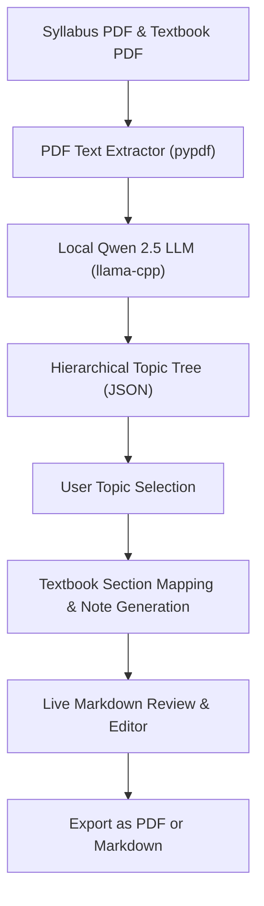

# TopicTrace 📚

> **Local & Offline AI-Driven Study Notes Generator** built with Python, Streamlit, and `llama-cpp-python`.

TopicTrace extracts topics from your **Course Syllabus**, cross-references and maps them against your **Textbook PDF**, and generates structured, hallucination-free study notes. If a syllabus topic is missing from the textbook, the notes will explicitly flag it.

By default, TopicTrace runs **100% locally and offline** using a lightweight, quantized local model (**Qwen 2.5 1.5B Instruct**) directly on your CPU. No API keys, no internet connection, and no third-party data sharing required.

---

## Key Highlights

- 🖥️ **100% Offline Local Model:** Powered by `llama_cpp` running **Qwen 2.5 1.5B Instruct** (4-bit GGUF). Loads into memory in ~0.5s and consumes ~1.2 GB RAM with fast CPU multi-threading.
- 🔒 **Complete Privacy & Zero Cost:** Operates without any API keys, usage limits, or external server dependencies.
- 🎯 **Strict Anti-Hallucination Grounding:** Prompts ensure study notes are derived strictly from textbook content. Missing topics are prominently marked with `⚠️ Missing from Textbook`.
- ⚡ **Smart Context Windowing:** Automatically indexes textbook pages and supplies relevant sections to the local model to maximize inference speed.
- ✏️ **Interactive Human Review:** Live Markdown editor with real-time formatted preview.
- 📑 **Dual-Format Export:** One-click download as clean Markdown (`.md`) or formatted, paginated PDF (`.pdf`) using `fpdf2`.
- ☁️ *(Optional)* **Cloud Fallbacks:** Optional sidebar toggles for Google Gemini and Groq if cloud processing is ever desired.

---

## Project Structure

```
topictrace/
├── app.py             # Streamlit application & interactive UI
├── extractor.py       # PDF text and metadata extraction using pypdf
├── llm_service.py     # Local Llama-cpp engine & grounded note generator
├── exporter.py        # PDF (fpdf2) and Markdown export engine
├── models/            # Directory storing local GGUF weights (git-ignored)
│   └── qwen2.5-1.5b-instruct-q4_k_m.gguf
├── requirements.txt   # Python dependencies
├── .env.example       # Optional cloud API key template
├── .gitignore         # Ignores .venv, cache, and large model weights
└── instructions.md    # Original MVP specification
```

---

## Installation & Setup

### 1. Prerequisites
- Linux / macOS / Windows
- Python 3.10+ (Tested up to Python 3.14)
- C++ compiler (`gcc` or `clang`) and `cmake` for `llama-cpp-python`

### 2. Set Up Virtual Environment & Dependencies

```bash
# Clone the repository
git clone https://github.com/pannagaJois/topictrace.git
cd topictrace

# Create and activate virtual environment
python3 -m venv .venv
source .venv/bin/activate

# Install dependencies (includes llama-cpp-python, pypdf, fpdf2, streamlit)
pip install -r requirements.txt
```

### 3. Download the Local Model (One-Time Setup)

Download the quantized Qwen 2.5 1.5B GGUF weights into the `models/` folder:

```bash
python3 -c "
from huggingface_hub import hf_hub_download
hf_hub_download(
    repo_id='Qwen/Qwen2.5-1.5B-Instruct-GGUF',
    filename='qwen2.5-1.5b-instruct-q4_k_m.gguf',
    local_dir='models'
)
"
```
*(The model is ~980 MB and only needs to be downloaded once).*

### 4. Launch TopicTrace

```bash
streamlit run app.py
```

Open your browser at `http://localhost:8501`.

---

## How It Works



1. **Upload Documents:** In the left sidebar, upload your **Syllabus PDF** and **Textbook PDF**.
2. **Local Engine Active:** The sidebar defaults to **`🖥️ Local Model (Qwen 2.5 1.5B - Offline & Free)`** with no API key required.
3. **Parse Hierarchy:** Click **"🚀 Parse Syllabus Topics"**. The local model analyzes the course structure and extracts units, topics, and subtopics into an interactive checklist.
4. **Select & Generate:** Check the topics you need, then click **"📝 Generate Study Notes"**. The local model cross-references textbook sections and compiles grounded notes.
5. **Review & Edit:** Edit, refine, or add notes in the live Markdown editor with side-by-side preview.
6. **Export:** Download your finalized notes as a clean Markdown file (`.md`) or a styled PDF document (`.pdf`).

---

## Optional Cloud Providers

While TopicTrace is optimized for local offline execution, you can optionally switch the AI Engine in the sidebar to cloud backends:
- **Google Gemini:** Supports `gemini-2.0-flash` with free tier keys from Google AI Studio.
- **Groq:** Ultra-fast cloud inference for `llama-3.3-70b` with free keys from Groq Console.
